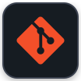

  

 

- 🚀 Building **scalable full-stack products powered by practical AI**.
- 🤖 Turning **complex ideas into intelligent, user-focused applications**.

 

---

## 🛠️ Tech Stack

  
  
  
  
  
  
  
  
  
  
  
  
  
  
  
  
  
  
  
  
  
  
  

---

## 🔥 Contributions & Streak

  

---

## 🤝 Connect with me

  
  
  
  

 

