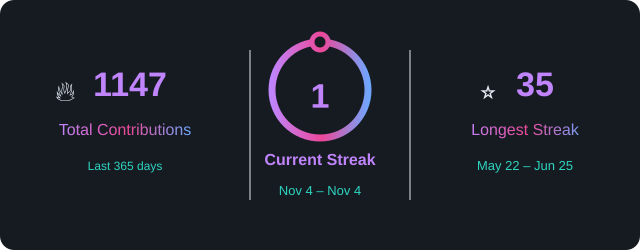

 
   <h1> Hey, I'm Virlanki Jaidheep 🏎️💨 </h1>
   <h4> race · react · respond </h4>

 

  

 

- 🚀 Currently working on **Full Stack with AI Integration**
- 🤖 Ask me about anything related to **AI & ML**
- 📬 Reach me at [virlankijaidheep@gmail.com](mailto:virlankijaidheepwork@gmail.com)

 

---

## 🛠️ Tech Stack

| **🎨 Frontend** <a href="https://react.dev/"> React</a> <a href="https://www.typescriptlang.org/"> TypeScript</a> <a href="https://www.javascript.com/"> JavaScript</a> <a href="https://html.spec.whatwg.org/"> HTML5</a> <a href="https://www.w3.org/Style/CSS/"> CSS3</a> <a href="https://tailwindcss.com/"> Tailwind CSS</a> <a href="https://getbootstrap.com/"> Bootstrap</a> <a href="https://www.figma.com/"> Figma</a> <a href="https://www.chartjs.org/"> Chart.js</a> <a href="https://www.adobe.com/products/illustrator.html"> Illustrator</a> | **⚙️ Backend** <a href="https://www.djangoproject.com/"> Django</a> <a href="https://nodejs.org/"> Node.js</a> <a href="https://expressjs.com/"> Express.js</a> <a href="https://aws.amazon.com/"> AWS</a> <a href="https://www.cprogramming.com/"> C</a> <a href="https://wordpress.org/"> WordPress</a> |
|:--|:--|
| **🤖 AI &amp; ML** <a href="https://www.python.org/"> Python</a> <a href="https://www.tensorflow.org/"> TensorFlow</a> <a href="https://pytorch.org/"> PyTorch</a> <a href="https://scikit-learn.org/"> scikit-learn</a> <a href="https://www.r-project.org/"> R</a> <a href="https://powerbi.microsoft.com/"> Power BI</a> <a href="https://www.tableau.com/"> Tableau</a> | **🗄️ Database** <a href="https://www.mongodb.com/"> MongoDB</a> <a href="https://www.postgresql.org/"> PostgreSQL</a> <a href="https://www.mysql.com/"> MySQL</a> <a href="https://www.oracle.com/database/"> Oracle DB</a> |

---

## 🔥 Contributions & Streak

  

---

## 🤝 Connect with me

  
  
  

 

